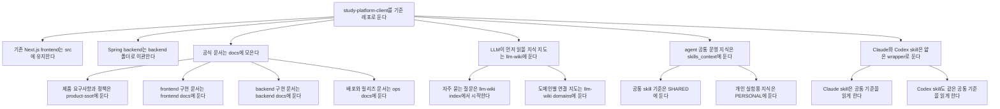
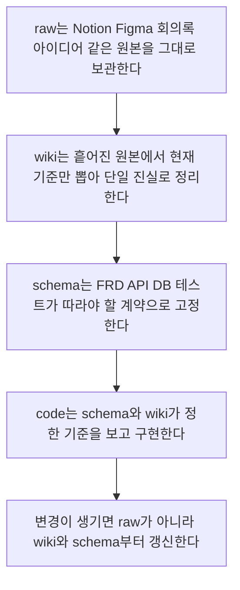
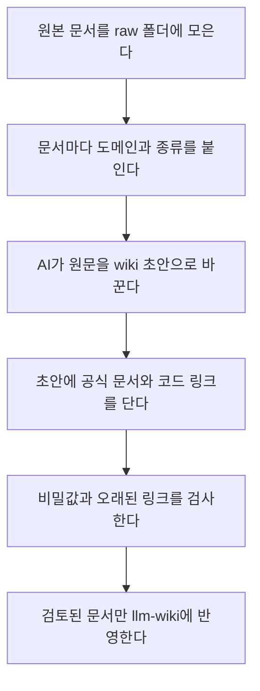
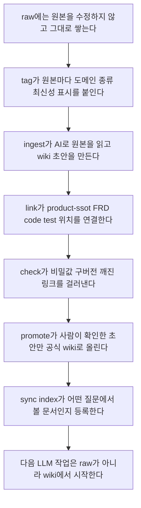
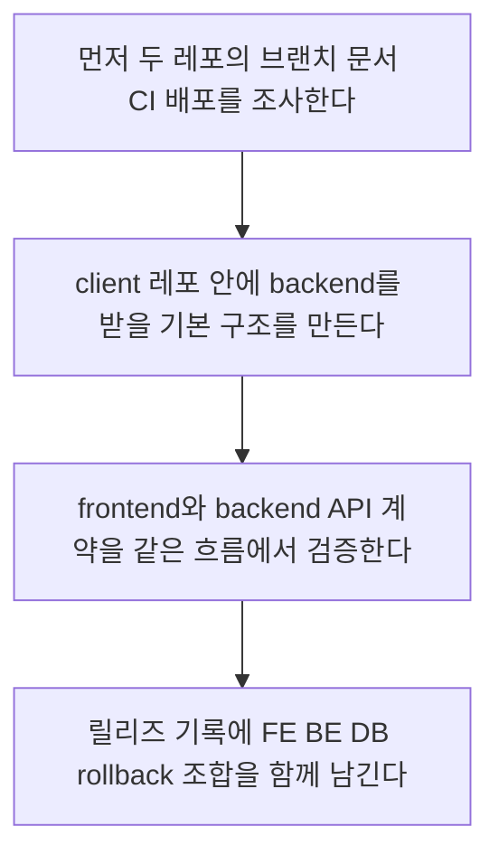
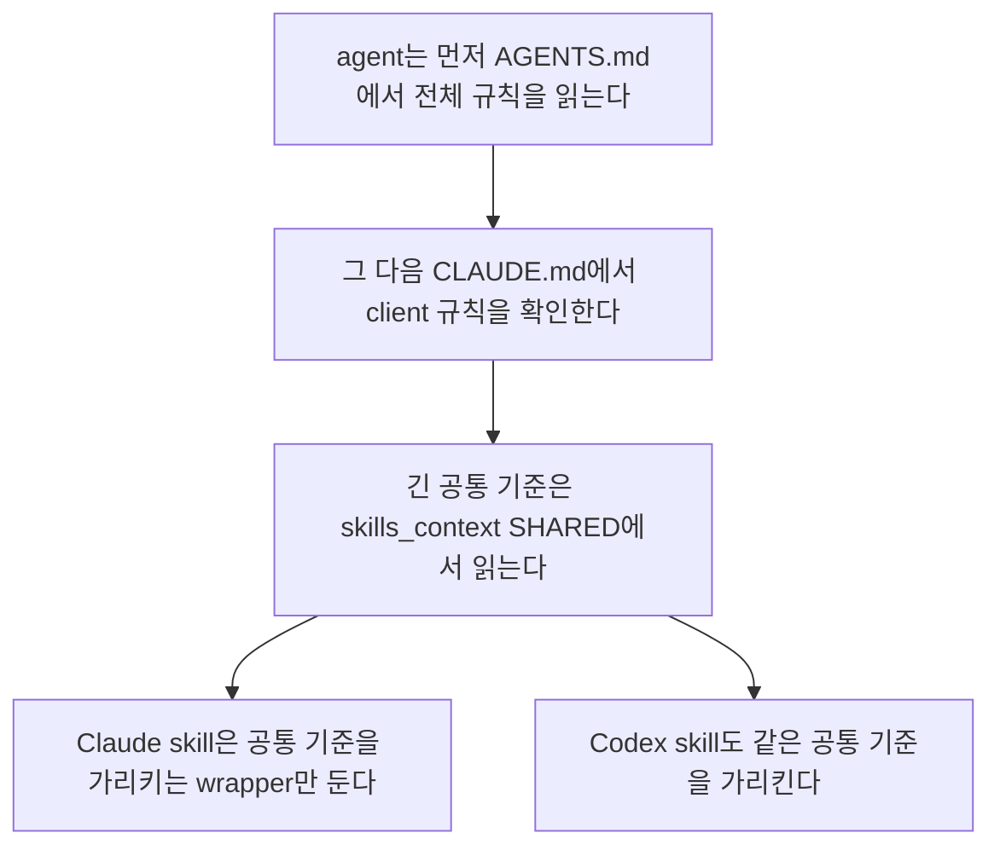
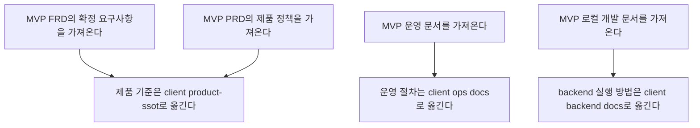
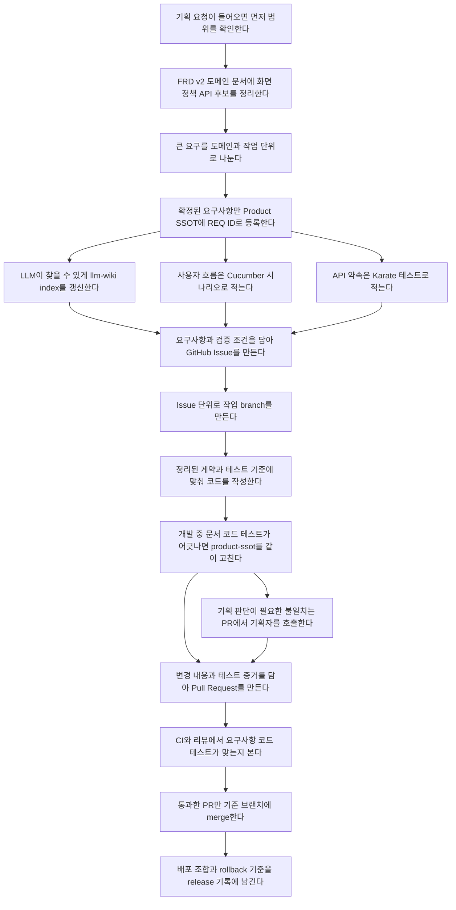
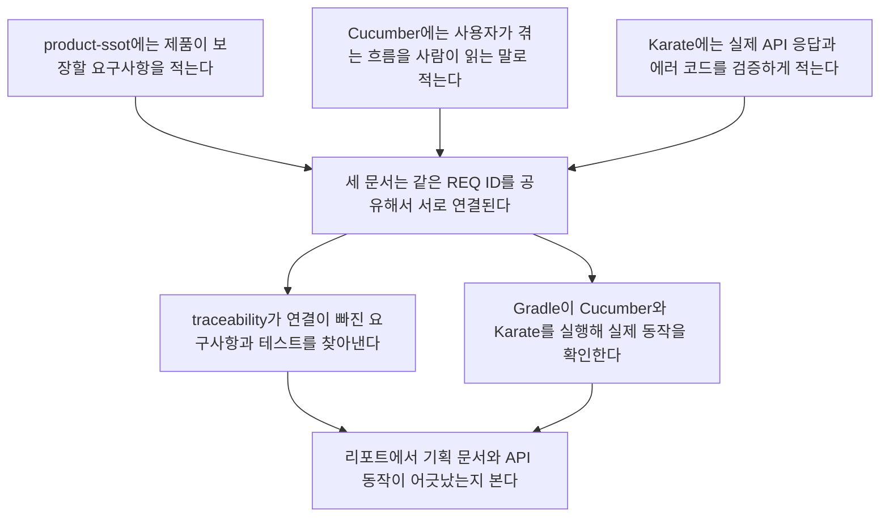
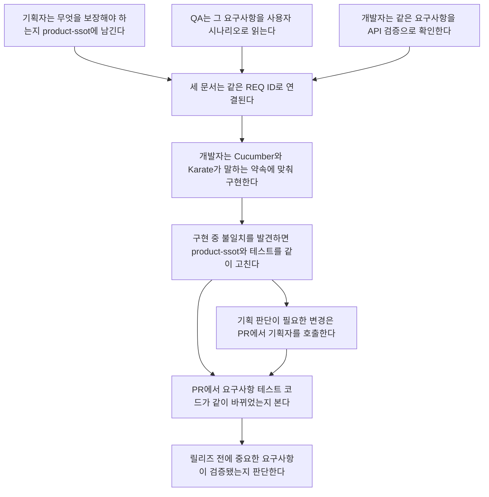

# Monorepo / LLM Wiki / Skill 핵심 요약

작성일: 2026-05-28  
목적: study-platform 단일 레포 전환, LLM wiki, agent skill 운영 기준을 Notion에 한 장으로 정리한다.

## 1. 한 줄 결론

`study-platform-client`를 기준 레포로 삼고, backend를 단계적으로 흡수한다.  
제품 요구사항/정책 원장은 `docs/product-ssot/`에 둔다.  
LLM이 빠르게 읽고 연결할 지식 지도는 프로젝트 루트의 `llm-wiki/`에 별도로 둔다.  
agent skill은 긴 지식을 복사하지 않고 `skills_context/SHARED/`, `docs/`, `llm-wiki/`를 읽는 얇은 wrapper로 둔다.

왜 이렇게 하느냐가 핵심이다.

- frontend와 backend가 다른 레포에서 각자 맞다고 통과하면, 실제 제품 조합이 맞는지 끝까지 불안하다.
- Notion, FRD, PRD, product-ssot, 코드, 테스트가 따로 있으면 “최신 기준과 연결 지도가 어디인지”를 매번 사람이 기억해야 한다.
- agent skill에 지식을 복사해 넣으면 Claude/Codex/사람 문서가 서로 달라진다.
- 그래서 한 레포, 한 제품 기준 원장, 한 LLM 지식 지도, 한 요구사항 ID로 기획-개발-검증을 연결한다.

## 1.1 설득 포인트

| 주제 | 왜 필요한가 | 기대 효과 |
| --- | --- | --- |
| Monorepo | frontend/backend/release 조합을 한 곳에서 검증해야 한다 | 배포 직전 contract mismatch를 줄인다 |
| LLM Wiki | 제품 기준과 구현 맥락이 Notion/FRD/코드에 흩어져 있다 | LLM과 사람이 같은 지식 지도를 본다 |
| Skill Harness | agent마다 다른 규칙을 읽으면 결과가 흔들린다 | Claude/Codex가 같은 SSOT로 작업한다 |
| Cucumber + Karate | 기획 문장과 API 동작 사이에 번역 손실이 생긴다 | 요구사항, 시나리오, API 테스트가 같은 ID로 연결된다 |

## 2. 목표 구조



```text
study-platform-client/
  src/                         # 기존 Next.js frontend
  backend/                     # study-platform-mvp Spring Boot backend 이관

  docs/
    product-ssot/              # 제품 요구사항/정책/결정의 canonical 원장
      _shared/
        notion-source-registry.yaml
      auth/
      class/
      course/
      payment/
      notification/

    frontend/                  # frontend 구현/UX/API 사용 문서
    backend/                   # backend 구현/API/DB/Flyway/local 문서
    ops/                       # 배포/릴리즈/마이그레이션 runbook

  llm-wiki/                    # LLM이 우선 읽는 지식 지도와 연결 문서
    README.md
    index.md
    domains/
    workflows/
    decisions/
    sessions/

  skills_context/
    SHARED/                    # Claude/Codex 공통 skill SSOT
    PERSONAL/                  # 개인 실험/보조 skill context

  .codex/skills/               # Codex wrapper skill
  .claude/skills/              # Claude wrapper skill
  releases/                    # production release record
```

## 3. 문서 위치 원칙

| 위치 | 역할 |
| --- | --- |
| `docs/product-ssot/` | 제품 기준. 요구사항, 정책, 용어, 결정, traceability |
| `llm-wiki/` | LLM용 지식 지도. product-ssot, docs, code, test를 연결 |
| `docs/frontend/` | React/Next.js 구현, UI/UX, frontend API 사용법 |
| `docs/backend/` | Spring API, DB, Flyway, backend local/dev 운영 |
| `docs/ops/` | 배포, 릴리즈, rollback, migration, incident runbook |
| `skills_context/SHARED/` | Claude/Codex가 같이 읽는 skill source of truth |
| `.omc/wiki/` | 세션 중 임시 wiki. repo 기준 문서 아님 |

## 3.1 Monorepo 장점

Monorepo의 장점은 “폴더를 하나로 합치는 것”이 아니다. 제품을 하나의 실행 가능한 조합으로 검증할 수 있다는 점이다.

| 현재 분리 상태의 문제 | Monorepo에서 좋아지는 점 |
| --- | --- |
| frontend는 `develop`, backend는 `dev`에서 각각 통과하지만 둘의 조합이 같은 시점인지 모른다 | 같은 branch/PR/CI에서 FE-BE contract를 같이 본다 |
| API 변경 후 frontend 반영이 늦게 발견된다 | backend OpenAPI 변경과 frontend generate/usage를 같은 작업 흐름에 묶는다 |
| 릴리즈 기록이 frontend/backend/DB로 흩어진다 | release record에 FE/BE/DB/rollback 조합을 함께 남긴다 |
| 장애 때 어느 repo의 어느 버전 조합인지 추적이 느리다 | 하나의 commit/PR/release 기록으로 추적한다 |
| 문서와 코드의 위치가 분리되어 agent가 맥락을 놓친다 | agent가 한 workspace에서 product/code/test/release를 함께 읽는다 |

설득 문장:

> Monorepo는 개발자 편의를 위한 정리가 아니라, 제품이 실제로 배포되는 조합을 한 번에 검증하기 위한 운영 구조다.

## 4. Product SSOT 도메인 구조

도메인 문서는 필요할 때만 만든다. 빈 폴더를 대량 생성하지 않는다.

```text
docs/product-ssot/{domain}/
  README.md                    # 도메인 범위와 관련 문서 링크
  requirements.yaml            # REQ-* 요구사항 원장
  glossary.md                  # 용어, 상태값, role, enum 의미
  flows/*.md                   # 사용자/시스템 흐름
  policies/*.md                # 제품 정책
  decisions/ADR-*.md           # 중요한 결정 기록
  traceability.md              # 요구사항 ↔ API/E2E/manual evidence 연결
```

우선순위 도메인:

1. `auth`
2. `class`
3. `course`
4. `payment`
5. `notification`

## 5. LLM Wiki 구축 흐름



```text
raw 원본 보관
→ wiki 단일 진실 정리
→ schema 계약 고정
→ code 구현
→ 변경 시 wiki와 schema 먼저 갱신
```

핵심 원칙:

- Notion 원문을 통째로 옮기지 않는다.
- 최신/구버전 문서를 동시에 active로 두지 않는다.
- 이미지 안의 정책은 텍스트로 풀어쓴다.
- secret, token, env value는 문서에 쓰지 않는다.
- LLM이 자주 찾는 질문은 `llm-wiki/index.md`에 추가한다.

## 5.1 LLM Wiki 장점

LLM wiki의 장점은 “문서를 많이 저장하는 것”이 아니다. LLM과 사람이 오래된 문서에 속지 않게 만드는 것이다.

| 문제 | LLM Wiki에서 해결하는 방식 |
| --- | --- |
| Notion 원문이 많고 최신/구버전이 섞인다 | `docs/product-ssot/_shared/notion-source-registry.yaml`에서 freshness와 active/deprecated를 관리한다 |
| LLM이 오래된 정책을 답변 근거로 삼는다 | `llm-wiki/index.md`에서 먼저 볼 canonical 문서를 지정한다 |
| 큰 문서 하나가 너무 길어 필요한 정책을 찾기 어렵다 | `llm-wiki/domains`, `workflows`, `decisions`로 연결 지도를 쪼갠다 |
| 사람은 Notion을 보고 agent는 다른 파일을 본다 | repo root의 `llm-wiki/`를 LLM 진입점으로 둔다 |
| 작업이 끝나도 배운 내용이 다음 세션에 남지 않는다 | 반복 가치가 있는 지식만 `llm-wiki/`, `docs/`, `skills_context` 중 맞는 곳으로 승격한다 |

설득 문장:

> LLM wiki는 product-ssot를 대체하는 문서가 아니라, product-ssot와 구현 문서를 정확히 찾아가게 하는 지식 지도다.

## 6. Skill 운영 원칙

skill은 “지식 저장소”가 아니라 “작업 진입점”이다.

- 긴 정책/절차는 성격에 따라 `docs/`, `llm-wiki/`, `skills_context/SHARED/`에 둔다.
- `.codex/skills/*`, `.claude/skills/*`는 해당 문서를 읽는 wrapper로 유지한다.
- Claude와 Codex가 같은 SSOT를 보게 만든다.
- 반복되는 작업만 skill로 승격한다.

## 6.1 Skill Harness 장점

skill harness의 장점은 agent를 많이 만드는 것이 아니다. 같은 일을 시킬 때 같은 기준으로 움직이게 하는 것이다.

| 문제 | 개선 효과 |
| --- | --- |
| Claude와 Codex skill 내용이 달라진다 | 둘 다 `skills_context/SHARED/`를 읽게 한다 |
| skill 파일에 긴 정책을 복사해 업데이트가 어렵다 | wrapper는 얇게 두고 긴 기준은 SSOT에 둔다 |
| agent가 매번 다른 방식으로 계획/검증한다 | workflow를 skill로 고정해 반복 품질을 높인다 |
| 사람이 “왜 이렇게 했는지” 추적하기 어렵다 | skill이 읽은 SSOT와 산출물 위치가 명확해진다 |
| 새 agent가 들어올 때 학습 비용이 크다 | `AGENTS.md` → `CLAUDE.md` → `skills_context/SHARED` 순서로 기준을 찾는다 |

설득 문장:

> Skill harness는 자동화를 늘리는 장치가 아니라, agent가 프로젝트의 같은 기준을 반복해서 지키게 만드는 운영 장치다.

## 7. LLM Wiki 자동 문서화 Skill 설계



여기서 말하는 skill은 기존 agent skill 추천이 아니라, `llm-wiki/`를 자동으로 채우기 위해 새로 만드는 프로젝트 전용 문서화 skill이다.

| 새 Skill | 역할 | 결과물 |
| --- | --- | --- |
| `/tag` | `raw/`에 쌓인 원본문서를 domain/type/status로 분류 | tag metadata, 이동 후보 |
| `/ingest` | 원본 자료를 AI가 읽고 wiki page 초안으로 변환 | `llm-wiki/domains/*.md`, `workflows/*.md` 초안 |
| `/link` | wiki page를 product-ssot, FRD, code, test와 연결 | 관련 문서 링크, `REQ-*` 연결 |
| `/check` | wiki 문서 품질과 금지사항 검증 | broken link, secret, stale source 체크 |
| `/promote` | 검토된 임시 wiki를 공식 `llm-wiki/`로 승격 | review-ready wiki page |
| `/sync-index` | 변경된 wiki page를 index에 반영 | `llm-wiki/index.md` 갱신 |

## 8. LLM Wiki 문서 생성 Pipeline



권장 raw 구조:

```text
llm-wiki/
  raw/
    notion/
    frd/
    prd/
    meeting/
    incident/
  domains/
  workflows/
  decisions/
  index.md
```

각 skill이 지켜야 할 원칙:

- `/ingest`는 원문을 그대로 복사하지 않고 핵심 요약과 canonical 링크를 만든다.
- `/tag`는 문서를 `auth`, `class`, `course`, `payment`, `notification` 같은 domain으로 분류한다.
- `/link`는 제품 요구사항이면 `docs/product-ssot/{domain}/requirements.yaml`의 `REQ-*`와 연결한다.
- `/check`는 secret, token, env value, 오래된 source, broken link를 잡는다.
- `/promote`는 사람이 검토한 초안만 공식 `llm-wiki/`에 반영한다.

## 9. 마이그레이션 핵심 단계



### Phase 0. Inventory

- client `develop`, backend `dev` 상태 확인
- 미병합 PR, release branch, env 파일, CI/deploy 흐름 목록화
- frontend API 사용처와 backend controller 매핑

### Phase 1. Monorepo Shell

- `study-platform-client/backend/`에 backend 이관
- frontend 기존 검증 유지
- backend `./gradlew compileJava` 가능하게 정리
- 기존 backend repo는 바로 삭제하지 않고 read-only 전환 준비

### Phase 2. Contract Bridge

- backend OpenAPI export 표준화
- frontend OpenAPI generate/usage 정책 표준화
- frontend/backend contract mismatch를 같은 repo 안에서 검증

### Phase 3. Release 통합

- `main`: production
- `develop`: QA/staging/test-server
- release record는 frontend/backend/DB/rollback 조합을 함께 기록

## 10. 완료 기준

- 제품 질문이 `llm-wiki/index.md`에서 1~2개 canonical 문서로 연결된다.
- active/deprecated 문서가 섞이지 않는다.
- frontend/backend/ops/product 문서 위치가 분리되어 있다.
- skill wrapper는 얇고, 긴 기준은 `docs/`, `llm-wiki/`, `skills_context/SHARED/` 중 맞는 위치에 있다.
- monorepo에서 frontend/backend contract를 함께 검증할 수 있다.

## 11. 프젝 하네스 점검

현재 점검 포인트는 세 가지다.

### 11.1 Client agent harness 개선

현재 client 쪽 agent surface는 `.claude/` 중심으로 사용 중이다.



개선 대상:

- `.claude/skills/*`에 실제 긴 지식이 들어가 있으면 `skills_context/SHARED/`로 분리한다.
- `.codex/skills/*`와 `.claude/skills/*`는 같은 `skills_context/SHARED/` 문서를 읽는 얇은 wrapper로 맞춘다.
- client 전용 규칙, release 규칙, LLM wiki 규칙을 서로 다른 위치에 중복 저장하지 않는다.
- 새 agent가 들어와도 `AGENTS.md` → `CLAUDE.md` → `skills_context/SHARED/*` 순서로 기준을 찾을 수 있게 만든다.

목표 상태:

```text
skills_context/
  SHARED/
    study-platform-fullstack-context.md
    study-platform-llm-wiki.md
    study-platform-skill-governance.md
    zeroone-version-management.md

.claude/skills/*    # wrapper only
.codex/skills/*     # wrapper only
```

### 11.2 MVP FRD 구조 이관

`study-platform-mvp`의 FRD 구조는 버리지 않고 그대로 가져온다.



이관 원칙:

- MVP의 검증된 FRD/PRD/product-ssot 구조를 client monorepo의 `docs/product-ssot/` 기준으로 흡수한다.
- 기존 FRD 문서의 요구사항 ID, domain 분류, decision 기록, traceability 구조를 유지한다.
- frontend 구현 문서와 backend 구현 문서는 product-ssot에 섞지 않고 각각 `docs/frontend/`, `docs/backend/`로 분리한다.
- 이관 후 old MVP repo는 바로 삭제하지 않고 read-only/archive 후보로 둔다.

권장 매핑:

```text
study-platform-mvp/docs/FRD/*
→ study-platform-client/docs/product-ssot/{domain}/

study-platform-mvp/docs/PRD/*
→ study-platform-client/docs/product-ssot/{domain}/requirements.yaml 또는 policies/*.md

study-platform-mvp/docs/operations/*
→ study-platform-client/docs/ops/

study-platform-mvp/docs/local-development/*
→ study-platform-client/docs/backend/
```

### 11.3 Product SSOT 보강

`product-ssot`는 LLM wiki가 아니라 제품 요구사항/정책/결정의 기준 원장이다.

반드시 있어야 하는 shared 문서:

```text
docs/product-ssot/_shared/
  notion-source-registry.yaml
  traceability-rules.md
  testing-layer-policy.md
```

domain별 최소 구조:

```text
docs/product-ssot/{domain}/
  README.md
  requirements.yaml
  glossary.md
  flows/*.md
  policies/*.md
  decisions/ADR-*.md
  traceability.md
```

보강 우선순위:

1. MVP FRD에서 이미 정리된 domain을 먼저 이관한다.
2. 요구사항과 정책은 `requirements.yaml`, `policies`, `decisions`에 둔다.
3. active/deprecated 판단이 필요한 원문은 `notion-source-registry.yaml`에 등록한다.
4. product 정책은 `docs/product-ssot/`, 구현 상세는 `docs/frontend/` 또는 `docs/backend/`로 분리한다.
5. 모든 batch는 `git diff --check`와 secret 포함 여부를 확인한다.

### 11.4 LLM Wiki 보강

`llm-wiki/`는 product-ssot와 별도 폴더다. 역할은 제품 원장을 대체하는 것이 아니라, LLM이 product-ssot, FRD, 구현 문서, 테스트를 빠르게 찾아가게 하는 지식 지도다.

필수 구조:

```text
llm-wiki/
  README.md
  index.md
  domains/
    auth.md
    class.md
    course.md
    payment.md
    notification.md
  workflows/
    planning-to-development.md
    issue-pr-release.md
  decisions/
    monorepo.md
    cucumber-karate.md
  sessions/
```

보강 우선순위:

1. LLM이 자주 헷갈리는 질문을 `llm-wiki/index.md`에 등록한다.
2. 각 wiki 문서는 원문을 복사하지 않고 canonical 문서 링크와 요약을 둔다.
3. 제품 요구사항 본문은 `docs/product-ssot/`에 두고, wiki에는 어디를 봐야 하는지 적는다.
4. 구현 상세는 `docs/frontend/`, `docs/backend/`로 연결한다.
5. 세션 중 발견한 임시 지식은 `.omc/wiki/`에서 검토 후 `llm-wiki/`로 승격한다.

## 12. 프젝 하네스 기획에서 개발까지 작동 흐름

기획은 `FRD/v2.0/{domain}` 같은 버전 산출물에서 시작하고, 확정된 요구사항만 `product-ssot`로 승격한다. 단, `product-ssot`는 기획자만 관리하는 문서가 아니다. 개발 중 코드, API, 테스트, 기존 정책이 서로 맞지 않는 지점을 발견하면 개발자가 바로 `product-ssot`를 함께 수정하고 PR로 올린다. 기획 판단이 필요한 변경은 PR에서 기획자를 호출해 확인받는다. LLM이 찾을 연결 지도는 `llm-wiki/`에 갱신한다. 코드는 `product-ssot`와 테스트 tag가 잡힌 뒤 작성한다.



### 12.1 단계별 역할

| 단계 | 채우는 위치 | 하는 일 | 코드 작성 여부 |
| --- | --- | --- | --- |
| 기획 수집 | `docs/FRD/v2.0/{domain}/` | 화면, 정책, API 후보, 도메인 범위 정리 | X |
| 도메인 분해 | `docs/FRD/v2.0/{domain}/1-5-audit/` | source coverage, blocker, artifact routing 정리 | X |
| 구현 계약 정리 | `docs/FRD/v2.0/{domain}/1-7-implementation/` | API contract, DB schema, screen map, backlog 작성 | X |
| 요구사항 승격 | `docs/product-ssot/{domain}/requirements.yaml` | 확정 정책을 `REQ-*`로 등록 | X |
| 정책/결정 기록 | `docs/product-ssot/{domain}/policies`, `decisions` | 충돌 결정, 예외, 정책 확정 | X |
| LLM Wiki 갱신 | `llm-wiki/index.md`, `llm-wiki/domains/*` | LLM이 product-ssot/docs/test를 찾아가게 링크와 요약 작성 | X |
| 테스트 명세 연결 | `features/acceptance`, `features/api` | `@REQ-*` tag로 Cucumber/Karate 연결 | X |
| 이슈 생성 | GitHub Issue | 범위, 요구사항 ID, 검증 조건, PR 분해 기준 작성 | X |
| 브랜치 생성 | Git branch | issue 단위 작업 branch 생성 | X |
| 코드 작성 | `backend/`, `src/` | contract와 요구사항 기준으로 구현 | O |
| 개발 중 SSOT 보정 | `docs/product-ssot/{domain}/` | 구현 중 발견한 문서/코드/API/test 불일치를 즉시 수정 | O |
| 기획자 확인 요청 | GitHub Pull Request | 제품 판단이 필요한 불일치, 정책 변경, 예외를 기획자에게 호출 | O |
| PR 생성 | GitHub Pull Request | 코드, product-ssot, 테스트 evidence를 함께 연결 | O |
| 검증 | Gradle/Yarn/traceability | 테스트, typecheck, lint, traceability 확인 | O |
| merge | GitHub PR merge | review/CI 통과 후 기준 branch에 반영 | O |
| 릴리즈 | `releases/`, `docs/ops/` | FE/BE/DB/rollback 조합 기록 | O |

### 12.2 Product SSOT는 언제 채우나

`product-ssot`는 기획 초안 저장소가 아니다. 아래 조건을 만족할 때 채운다.

- FRD에서 domain과 범위가 분리됐다.
- 구현해야 할 정책이 old/new 충돌 없이 정리됐다.
- API 또는 사용자 흐름으로 검증 가능한 요구사항이다.
- PM/QA/개발자가 같은 문장으로 읽어도 의미가 흔들리지 않는다.
- Cucumber 또는 Karate의 `@REQ-*` tag로 연결할 수 있다.

또한 개발 중에는 아래 상황에서 개발자가 직접 갱신한다.

- 코드가 실제로 구현한 정책이 `product-ssot` 문장과 다르다.
- backend API 응답, error code, enum, 권한 정책이 문서와 다르다.
- Cucumber/Karate/Playwright 테스트가 요구사항과 다른 기준을 검증한다.
- 기존 요구사항끼리 충돌하거나 예외 케이스가 빠져 있다.
- 구현 과정에서 제품 판단이 필요한 선택지가 생겼다.

이때 개발자는 조용히 코드만 맞추지 않는다. `product-ssot` 수정, 테스트 수정, 코드 수정을 같은 PR에 올리고, 제품 판단이 필요한 부분은 PR에서 기획자에게 확인 요청한다.

### 12.3 코드는 언제 작성하나

코드는 다음이 준비된 뒤 작성한다.

- `requirements.yaml`에 최소 요구사항 ID가 있다.
- acceptance/API test로 검증할 핵심 흐름이 정해졌다.
- backend API contract 또는 frontend 소비 contract가 정리됐다.
- 미결정 정책은 `decisions/` 또는 backlog에 남겼다.
- 구현 PR에서 어떤 검증을 돌릴지 정해졌다.

코드 작성 중에 문서와 구현이 어긋나면 코드만 고치고 끝내지 않는다. 요구사항 문장, 테스트 tag, API 계약 중 무엇이 진짜 기준인지 확인하고 `product-ssot`를 최신 기준으로 갱신한다.

## 13. Cucumber + Karate 도입 방식

현재 `study-platform-mvp`는 인증 도메인부터 Cucumber + Karate를 도입하고 있다.

핵심은 `requirements.yaml`의 `REQ-*` 요구사항을 Cucumber/Karate feature tag와 연결하는 것이다.

쉽게 말하면, 기획 문장과 실제 API 테스트가 같은 계약을 보게 만드는 방식이다.

- `requirements.yaml`: 제품이 보장해야 하는 요구사항
- Cucumber: PM/QA/개발자가 같이 읽는 사용자 흐름
- Karate: 실제 API가 그 약속을 지키는지 확인하는 테스트
- `@REQ-*`: 요구사항과 테스트를 연결하는 공통 표식

이렇게 하면 “문서에는 된다고 되어 있는데 실제 API는 다른 동작을 하는 문제”를 줄일 수 있다.



### 13.1 현재 MVP 도입 상태

| 항목 | 현재 기준 |
| --- | --- |
| 첫 도입 domain | `auth` |
| 요구사항 원장 | `docs/product-ssot/auth/requirements.yaml` |
| 결정 문서 | `docs/product-ssot/auth/decisions/ADR-0001-requirements-yaml-cucumber-karate.md` |
| Cucumber version | `7.20.1` |
| Karate version | `1.4.1` |
| Testcontainers version | `2.0.5` |
| Cucumber task | `./gradlew cucumberAcceptanceTest` |
| Karate task | `./gradlew karateApiTest` |
| Traceability task | `./gradlew verifyAuthTraceability` |
| 호환 alias | `./gradlew karateAuthIntegrationTest` |

### 13.2 왜 도입하나

Cucumber + Karate의 목적은 테스트 도구를 늘리는 것이 아니라, 기획과 개발 사이의 번역 손실을 줄이는 것이다.

| 문제 | 도입 후 기대 효과 |
| --- | --- |
| 기획 문서와 구현 코드가 따로 논다 | `REQ-*` ID로 요구사항, 시나리오, API 테스트를 연결한다 |
| PM/QA는 코드 테스트를 읽기 어렵다 | Cucumber가 자연어에 가까운 인수 시나리오를 제공한다 |
| 개발자는 기획 문장의 API 의미를 놓치기 쉽다 | Karate가 실제 status/body/error code를 검증한다 |
| 요구사항이 구현됐는지 수동으로 확인한다 | traceability task가 누락/고아 tag를 자동 확인한다 |
| 문서가 오래되면 아무도 모른다 | 테스트와 연결되지 않은 요구사항을 warning/fail로 드러낸다 |
| 개발 중 문서와 코드가 어긋난다 | 개발자가 `product-ssot`, 테스트, 코드를 같은 PR에서 함께 보정한다 |
| 제품 판단이 필요한 불일치가 숨어 지나간다 | PR에서 기획자를 호출해 정책 기준을 확정한다 |

### 13.3 장점

- 기획자는 “이 요구사항이 어떤 시나리오로 검증되는지” 볼 수 있다.
- QA는 테스트 케이스를 별도 엑셀로만 관리하지 않고 repo 안의 feature로 확인할 수 있다.
- 개발자는 구현 전에 어떤 API 동작을 맞춰야 하는지 명확히 본다.
- 리뷰어는 PR에서 요구사항 ID, feature, API 테스트를 함께 확인할 수 있다.
- 개발자는 구현 중 발견한 불일치를 `product-ssot`까지 같이 고쳐서 다음 작업자가 같은 문제를 반복하지 않게 한다.
- 기획자는 모든 구현 세부를 실시간으로 따라가지 않아도, PR에서 호출된 정책 판단 지점만 집중해서 확인할 수 있다.
- LLM은 `REQ-*`를 기준으로 제품 문서와 테스트를 같이 추적할 수 있다.
- 릴리즈 전에는 “중요 요구사항이 테스트 없이 남았는지” 자동으로 점검할 수 있다.

### 13.4 기획과 개발의 간극을 메우는 방식



핵심은 같은 요구사항을 세 관점에서 보는 것이다.

| 관점 | 보는 문서/테스트 | 질문 |
| --- | --- | --- |
| 기획 | `requirements.yaml` | 무엇을 보장해야 하는가 |
| QA | Cucumber feature | 사용자가 어떤 흐름을 기대하는가 |
| 개발 | Karate feature | API가 어떤 응답을 해야 하는가 |
| 개발 | `product-ssot` PR diff | 구현 중 발견한 불일치를 기준 문서에 반영했는가 |
| 기획 | PR review mention | 제품 판단이 필요한 변경을 확인했는가 |
| 리뷰어 | PR + traceability | 요구사항, 테스트, 코드가 같이 바뀌었는가 |

### 13.5 폴더 구조

```text
study-platform-mvp/
  docs/product-ssot/
    _shared/
      traceability-rules.md
      testing-layer-policy.md
    auth/
      requirements.yaml
      decisions/
        ADR-0001-requirements-yaml-cucumber-karate.md

  src/test/resources/
    features/
      acceptance/
        auth-login-logout.feature
      api/
        auth-dev-support-api.feature
        auth-integration-api.feature
        auth-no-auth-api.feature
        auth-qa-support-api.feature
    karate-config.js

  src/test/java/com/codezerotoone/mvp/
    acceptance/auth/
      CucumberAcceptanceTest.java
      AuthStepDefinitions.java
      AuthAcceptanceRuntime.java
    api/auth/
      KarateAuthDevSupportApiTest.java
      KarateAuthIntegrationApiTest.java
      KarateAuthNoAuthApiTest.java
      KarateAuthQaSupportApiTest.java
      KarateAuthSmsRuntimeTest.java
      KarateAuthTokenSupportRuntimeTest.java

  tools/traceability/
    verify-product-ssot-traceability.py
```

### 13.6 역할 분리

| 층 | 도구 | 역할 |
| --- | --- | --- |
| 요구사항 원장 | `requirements.yaml` | `REQ-*`, 상태, 우선순위, owner, 설명 관리 |
| 인수 시나리오 | Cucumber | PM/QA가 읽을 수 있는 상위 사용자 흐름 검증 |
| API 계약 테스트 | Karate | status code, response body, error code, auth 정책 검증 |
| 기술 보강 테스트 | JUnit/MockMvc 등 | 내부 분기, mapper, repository, edge case 검증 |
| 추적성 검증 | Python script + Gradle task | YAML 요구사항과 feature tag 연결 확인 |

### 13.7 운영 규칙

- 요구사항 ID는 `REQ-{DOMAIN}-{NUMBER}` 형식이다.
- Cucumber/Karate scenario에는 관련 `@REQ-*` tag를 붙인다.
- feature에 있는 `@REQ-*`가 YAML에 없으면 fail이다.
- active 요구사항이 feature에 전혀 없으면 초기에는 warning, 안정화 후 fail로 올릴 수 있다.
- Cucumber는 상위 비즈니스 흐름, Karate는 API 계약과 runtime path 검증을 맡는다.
- JUnit/MockMvc 테스트는 내부 구현 안정성 보강용이며, 기본적으로 `@REQ-*` 연결 의무는 없다.

### 13.8 Monorepo 이관 후 목표 구조

```text
study-platform-client/
  backend/
    docs/product-ssot/ 또는 ../docs/product-ssot/와 연결
    src/test/resources/features/
    src/test/java/.../acceptance/
    src/test/java/.../api/

  docs/product-ssot/
    auth/
    class/
    course/
    payment/
    notification/
```

최종 목표는 frontend/backend가 같은 repo 안에서 하나의 `REQ-*` 요구사항을 보고, Cucumber/Karate/Playwright/API contract가 같은 product source를 참조하게 만드는 것이다.
