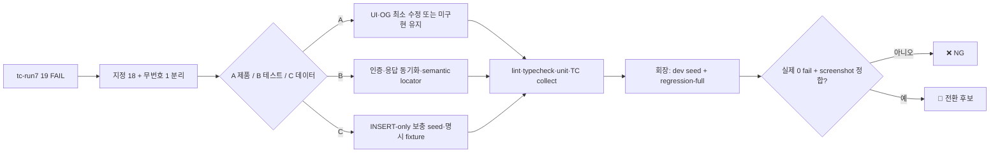

# SPRINT8 잔여 실패 QA 판정 — fix round 3 v1.0.0

| 항목 | 값 |
|---|---|
| 버전 | v1.0.0 |
| 작성일 | 2026-08-07 KST |
| 작성자/모델 | qa-verifier / gpt-codex/gpt-5.6-sol |
| 라인 | sprint8 |
| 상류 핀 | `pipeline-state.sprint8.md`: PRD v1.2.1 · FDD v1.3.1 · DESIGN v1.9.0 · prototype v9 |
| 입력 증거 | `tc-run7.log` 18 passed / 19 failed · `tc-fails3.txt` |
| 현재 릴리스 판정 | **❌ NG — dev 재실행·REG-002 Content API fixture·prototype 눈대조 전 PASS 금지** |

> **STAMP** — 생성 2026-08-07 19:32 KST · agent `qa-verifier` · skill `goal-lock` · 근거 [Playwright API testing](https://playwright.dev/docs/api-testing), [Playwright locators](https://playwright.dev/docs/locators), [Strapi REST API](https://docs.strapi.io/cms/api/rest), [Strapi upload API](https://docs.strapi.io/cms/api/rest/upload) · 고민: 로그의 19번째 무번호 회귀를 숨기면 회장 산정의 “실제 수정 15건”과 맞지 않으므로 18개 지정 TC와 별도 보조 회귀로 분리했다.

## 목차

- [1. 한 줄 결론](#1-한-줄-결론)
- [2. 범위와 진실원 결손](#2-범위와-진실원-결손)
- [3. 테스트 흐름과 커버리지](#3-테스트-흐름과-커버리지)
- [4. 18건 최종 판정표](#4-18건-최종-판정표)
- [5. 요구·수용기준·TC 추적](#5-요구수용기준tc-추적)
- [6. 반영 내용과 기존 기능 보존](#6-반영-내용과-기존-기능-보존)
- [7. REG-002 Strapi Content API 실행 명세](#7-reg-002-strapi-content-api-실행-명세)
- [8. 검증 증거와 재실행 계약](#8-검증-증거와-재실행-계약)
- [9. 프로토타입 정합·페르소나·회수](#9-프로토타입-정합페르소나회수)
- [10. 레드팀·셀프심문](#10-레드팀셀프심문)
- [11. 개정 이력](#11-개정-이력)

## 1. 한 줄 결론

지정 18건을 전수 분류해 **제품 4건(A)·테스트 8건(B)·데이터 6건(C)**으로 닫았고, 무번호 기존 회귀 1건의 제품 결함도 함께 수정했다. 정적·단위 증거는 통과했지만 사용자 제약상 dev 브라우저·seed·curl을 실행하지 않았으므로 **GH-001~003은 ❌ 제품 미구현, 나머지 15개 지정 TC는 ⬜ 재검증 대기, 🔧 전환 0건**이다.

요청 문장의 “나머지 15건”은 지정 목록상 14건이다. `tc-run7.log`의 19번째 실패인 무번호 `sprint8.spec.ts` 회귀 1건을 더하면 실제 수정 대상이 15건이 되며, 이를 별도 보조 회귀로 추적했다.

## 2. 범위와 진실원 결손

### 2.1 범위

- 포함: 지정 TC 18건 판정, 테스트 레이스·locator·fixture 수정, anonymous 섬 안내, OG fallback, INSERT-only 보충 seed, REG-002 Content API 실행 명세.
- 제외: GH-001~003 발행 콘솔 임의 구현, API·DB 스키마 변경, 원격 DB/Strapi 실행, dev 브라우저·curl, assertion 완화, push.
- 기존 구현 확인: SPRINT8 화면·E2E·round2 seed·OG metadata가 이미 존재했다. 그 위에 최소 보정했고 그린필드로 재창조하지 않았다.

### 2.2 필수 정본 확인

| 필수 입력 | 확인 결과 | 처리 |
|---|---|---|
| `CLAUDE.md` QA/완료 규율 | 확인 | 실제 경로 미관찰 항목을 PASS로 쓰지 않음 |
| `pipeline-state.sprint8.md` | `current_stage: qa`, `qa.status: in_progress` 관찰 | qa 미만이 아니므로 전환 편집 불필요 |
| `docs/구현현황.md` | worktree에 없음 | ⛔ 회수 필요 유지; 코드·round2 문서로 보완 |
| `docs/qa-tracker.md` | worktree에 없음 | 본 문서가 round3 증거 원장 역할; canonical tracker 부재 유지 |
| `docs/test-plan.md` | worktree에 없음 | `qa-sprint8-testcases-v1.0.0.md`의 69 TC/실행 계약 사용 |
| `docs/ONE_THING.md` / persona | worktree에 없음 | pipeline artifact 핀과 round2 페르소나 문항 사용 |
| 승인 prototype | parent design 산출물은 있으나 이번 제약상 새 구현 screenshot 없음 | 정합 미검증, QA PASS 금지 |

## 3. 테스트 흐름과 커버리지



| 커버리지 | 결과 |
|---|---:|
| 지정 TC 판정 | 18/18 (100%) |
| 실제 로그 실패 추적 | 19/19 (100%; 무번호 회귀 포함) |
| 수정 가능한 지정 TC | 14/14 반영, dev 미재실행 |
| 제품 미구현 고정 | GH-001~003 3/3 |
| 외부 Content API 필요 | REG-002 1/1 |
| regression-full | 미실행 — 사용자 실행 범위 |

## 4. 18건 최종 판정표

| TC | 분류 | 실제 원인 | 조치 | 현재 판정 |
|---|:---:|---|---|---|
| GH-001 | A | `E2E_SPRINT8_PUBLISH_CONSOLE_PATH`가 없는 것이 아니라 발행 콘솔 route·UI가 제품에 없음 | 가짜 경로·skip 금지, round2 판정 유지 | **❌ 제품 미구현** |
| GH-002 | A | 인라인 메일 편집·감사 이력 UI 미구현 | 임의 구현 금지, 실제 콘솔 build 뒤 재검증 | **❌ 제품 미구현** |
| GH-003 | A | 채널 선택·부분 발행·SNS 재발행 UI 미구현 | 임의 구현 금지, 실제 콘솔 build 뒤 재검증 | **❌ 제품 미구현** |
| GH-016 | B | API/스크린샷에는 잔액 문구가 있었지만 island query 완료 전에 5초 DOM 단정을 시작 | map+island GET 200을 기다린 뒤 동일 exact 문구 1개 검사 | ⬜ dev 재검증 |
| GH-017 | B | token으로 map만 읽고 브라우저 cookie를 넣지 않아 anonymous 화면을 회원 계약으로 검사 | `authenticate()`로 page와 API를 같은 회원 상태에 맞추고 응답 200 동기화 | ⬜ dev 재검증 |
| GH-020 | B | 수용기준은 모두 관찰됐으나 중첩 `<main>` 2개에 `locator('main')`을 적용해 strict-mode 실패 | 중복·비의미 assertion 제거; 제목·잠금 CTA·로그인 이유·무료 화두·금지문구 assertion 유지 | ⬜ dev 재검증 |
| GH-021 | B | 관계형 projection만 있고 Strapi 본문이 없는 첫 글을 골랐고, navigation과 무관한 2초 waiter가 먼저 종료 | 명시 Strapi slug 사용; sentinel 노출 뒤 scroll과 PUT response를 한 `Promise.all`로 결합 | ⬜ dev 재검증 |
| GH-022 | B | short article 자동 PUT과 2초 waiter/navigation 경쟁, 임의 projection 선택 | 명시 Strapi slug + navigation/PUT 동시 대기; `scrollY=0` 유지 | ⬜ dev 재검증 |
| GH-024 | C | round2 seed가 첫 zero-cost predecessor 1건만 READ 처리해 paid target이 NEXT가 되지 않음 | 알려진 paid slug의 모든 zero-cost predecessor를 981405에 INSERT-only READ 처리 | ⬜ seed+dev 재검증 |
| GH-025 | C | map에서 첫 cost0 projection을 골랐으나 해당 글은 Strapi body가 없어 제품 error 화면으로 전환 | `E2E_SPRINT8_FIRST_SLUG`의 실제 공개 Strapi 글만 검사, cost0 hard assertion 유지 | ⬜ dev 재검증 |
| GH-026 | C | 981407을 “개척 6곳”과 “잔액0 paid NEXT”가 공유해 paid NEXT가 모두 READ됨 | 별도 981410 balance0 회원 + paid predecessor READ seed; RBG001·무차감·URL 유지 assertion 보존 | ⬜ seed+dev 재검증 |
| GH-029 | C | synthetic unlinked article가 6섬 conquest 계산 뒤 추가돼 기존 여섯째 섬이 다시 미완독, 결과 5곳 | synthetic island required node를 981407 READ 후 conquest INSERT | ⬜ seed+dev 재검증 |
| GH-033 | C | 981408이 synthetic 1건만 READ해 해당 unlinked island가 우선 노출 조건을 만족하지 못함 | 같은 island required node 전부 READ + conquest INSERT; 깨진 링크·5xx 0 유지 | ⬜ seed+dev 재검증 |
| GH-037 | B | `/정답|맞히기/`가 보조 카피 “정답이 아니어도 됩니다”를 오탐 | 금지 UI label `정답`, `맞히기`를 각각 exact 검사; 프롬프트 2종 클릭 assertion 유지 | ⬜ dev 재검증 |
| GH-040 | B | 링크 accessible name에 카테고리·날짜·보완 수가 붙어 exact role name과 불일치 | 질문 visible text exact 검사로 semantic 대상 교정; route hit·쉬어감·지난 화두 유지 | ⬜ dev 재검증 |
| REG-002 | C | 관계형 SQL은 Strapi dynamic zone·upload media를 만들 수 없음 | 아래 `/api/upload` + `POST /api/articles` 실행 명세 제공 | **⬜ 회장 Content API 실행 필요** |
| REG-003 | A | 상대 OG fallback을 Next가 dev build origin `http://localhost:14855`로 절대화 | fallback을 공개 절대 URL로 고정, 정적 계약 테스트 추가 | ⬜ dev GET 200 재검증 |
| REG-005 | B | shell에서 JSON 따옴표가 벗겨져 `JSON.parse`가 제품 접근 전 실패 | JSON env 폐기, 두 scalar env + 고정 seed default로 변경 | ⬜ dev 재검증 |

### 보조 회귀 — 지정 18건 밖의 19번째 실패

| 테스트 | 분류 | 원인 | 조치 | 판정 |
|---|:---:|---|---|---|
| `sprint8.spec.ts` 바다·섬·화두 렌더 | A | anonymous `readingBudget=null`을 “모든 편 무료”로 오해해 후속 편에도 `늘 열려` 표시, 로그인 물때 안내도 숨김 | 비회원도 물때 설명 표시; cost0만 무료, cost1은 `로그인하면 이어서 엽니다`로 구분 | ⬜ dev 재검증 |

## 5. 요구·수용기준·TC 추적

| 요구 | 수용기준 | TC | 종료증거 |
|---|---|---|---|
| FR-006 발행 통제 | 콘솔 승인·편집·부분발행을 실제 상태로 관찰 | GH-001~003 | route/UI/state/side effect 실제 화면 — 현재 미구현 |
| FR-023 예산·잠금 표현 | 잔액은 섬 목록만, paid NEXT 1, 가격/자물쇠 0 | GH-016~017 | map/island 200 + DOM exact |
| FR-026 비회원 잠금 | 제목·이유·로그인·무료 대안, 401/상거래/5xx 0 | GH-020 | 상세 200 + DOM |
| FR-024 자동 완독 | 긴 글 sentinel 교차·짧은 글 무스크롤 모두 PUT 200 | GH-021~022 | progress PUT 200 + map 위치/scrollY |
| FR-026 소비·무료·잔액0 | 3→2, 첫 편 0→0, 잔액0 RBG001 | GH-024~026 | unlock JSON + 지도/DOM |
| FR-022 수평선 압축 | 20섬·개척6·나머지 압축 | GH-029 | map JSON + worldmap DOM |
| FR-027 미연결 공부방 | 준비 이유·대안, 링크/5xx 0 | GH-033 | map+dialog+response log |
| FR-016 보완 언어 | 프롬프트 2종 1클릭, 게임식 label 0 | GH-037 | exact buttons/textarea/negative labels |
| FR-007 재고0 후퇴 | 쉬어감과 지난 화두 동시 노출 | GH-040 | route hit 1 + DOM |
| NFR-05 미디어·SEO | 5종 DOM/asset 200, OG image 200 image/* | REG-002~003 | Strapi populate + anonymous GET |
| 기존 Q&A 이미지 | 상세 DOM과 원본 무인증 200 | REG-005 | scalar fixture path + GET 200 |

## 6. 반영 내용과 기존 기능 보존

### 6.1 유지한 기존 기능

- worldmap·섬 팝오버·공부방 직행·화두 무료 이동.
- 회원 reading budget, unlock toast, RBG001 회복 안내, 완독 sentinel.
- 공개 첫 편 전문, locked detail 비유출, OG article metadata.
- Q&A 이미지 DOM과 원본 URL assertion, 발행 콘솔 hard fail.
- 금지 규율: test skip/삭제, assertion bar 완화, timeout 숫자 증액, `optional:true` 모두 0건.

### 6.2 추가·변경한 것

- `gotoIslandAndWait`: map/island GET 200을 종료증거로 DOM assertion과 동기화.
- completion fixture: 임의 map 첫 글 대신 실제 Strapi slug를 명시.
- round3 seed: 981410 분리, paid predecessor, synthetic island conquest를 INSERT-only 보충.
- anonymous 섬 카피: 무료 편과 로그인 후속 편을 구분.
- OG fallback: localhost로 귀결되지 않는 공개 absolute URL.
- REG-005: fragile JSON shell quoting을 scalar env로 교체.

## 7. REG-002 Strapi Content API 실행 명세

### 7.1 가능 여부 결론

**가능하다.** Strapi 5는 media upload를 `POST /api/upload`, article document 생성을 `POST /api/articles`로 제공하고, dynamic zone의 각 row에 `__component`를 요구한다. component 자체 endpoint는 없으므로 article payload의 `blocks` 안에서 `shared.rich-text`를 생성해야 한다. media relation의 `connect`는 공식 비권장이라 cover/avatar는 upload 결과의 정수 file `id`를 media field 값으로 넣고, category/author만 document relation `connect`를 사용한다.

### 7.2 사전 확인

| 값 | 조회 | 종료조건 |
|---|---|---|
| Strapi base | 승인된 dev Strapi URL | prod가 아닌 dev instance |
| category documentId | `GET /api/categories?filters[slug][$eq]=deployment-operations&fields[0]=documentId` | 정확히 1건 |
| author documentId | `GET /api/authors?filters[email][$eq]=insight-editor@zeroone.local&fields[0]=documentId&populate[avatar]=true` | 정확히 1건 |
| 기존 fixture | `GET /api/articles?filters[slug][$eq]=qa-s8-reg-002-media-five&status=published` | 0건이면 create, 1건이면 재사용 |

모든 요청 header는 `Authorization: Bearer <FULL_ACCESS_TOKEN>`이다. 토큰 원문은 문서·shell history에 남기지 않는다.

### 7.3 업로드 요청

아래 endpoint에 cover PNG, body PNG, MP4, PDF, avatar PNG를 각각 업로드한다.

```http
POST {STRAPI_BASE}/api/upload
Authorization: Bearer <FULL_ACCESS_TOKEN>
Content-Type: multipart/form-data

files=@<local-file>
fileInfo={"name":"sprint8-reg002-<kind>","alternativeText":"SPRINT8 REG-002 fixture"}
```

응답은 배열이며 각 파일의 `id`(정수), `url`, `mime`을 기록한다. 다섯 `url` 모두 token 없는 GET 200이어야 다음 단계로 간다.

### 7.4 author avatar 연결

```http
PUT {STRAPI_BASE}/api/authors/{AUTHOR_DOCUMENT_ID}
Authorization: Bearer <FULL_ACCESS_TOKEN>
Content-Type: application/json

{"data":{"avatar":<AVATAR_FILE_ID>}}
```

### 7.5 article 생성·발행 payload

`BODY_IMAGE_URL`, `VIDEO_URL`, `ATTACHMENT_URL`은 upload 응답의 URL을 그대로 넣는다.

```http
POST {STRAPI_BASE}/api/articles
Authorization: Bearer <FULL_ACCESS_TOKEN>
Content-Type: application/json

{
  "data": {
    "title": "QA SPRINT8 미디어 5종 회귀",
    "description": "커버·본문 이미지·비디오·아바타·첨부 공개 경로 검증",
    "slug": "qa-s8-reg-002-media-five",
    "category": {"connect": ["<CATEGORY_DOCUMENT_ID>"]},
    "author": {"connect": ["<AUTHOR_DOCUMENT_ID>"]},
    "cover": <COVER_FILE_ID>,
    "blocks": [
      {
        "__component": "shared.rich-text",
        "body": "## 미디어 회귀 본문\n\n\n\n<video controls src=\"<VIDEO_URL>\"><source src=\"<VIDEO_URL>\" type=\"video/mp4\"></video>\n\n[첨부 내려받기](<ATTACHMENT_URL>)"
      }
    ],
    "publishedAt": "<NOW_ISO8601>"
  }
}
```

schema가 category를 단일 relation으로 강제해 `connect` 배열을 거부하면 `category:{"connect":[{"documentId":"..."}]}` longhand를 사용한다. 이 외 필드명·component UID가 실제 `GET ...?populate=*` 응답과 다르면 임의 추측으로 진행하지 말고 응답 schema를 회수한다.

### 7.6 검증·runner 입력

```http
GET {STRAPI_BASE}/api/articles?filters[slug][$eq]=qa-s8-reg-002-media-five&status=published&populate[cover]=true&populate[author][populate][avatar]=true&populate[blocks]=true
Authorization: Bearer <FULL_ACCESS_TOKEN>
```

응답에서 실제 URL을 읽어 다음 값을 **작은따옴표로 전체 감싸** 주입한다.

```sh
export E2E_SPRINT8_MEDIA_JSON='{"slug":"qa-s8-reg-002-media-five","cover":"<COVER_URL>","bodyImage":"<BODY_IMAGE_URL>","video":"<VIDEO_URL>","avatar":"<AVATAR_URL>","attachment":"<ATTACHMENT_URL>"}'
```

## 8. 검증 증거와 재실행 계약

### 8.1 이번 워커가 직접 실행한 증거

| 관문 | 결과 | 증거 등급 |
|---|---|---|
| pipeline stage | `current_stage: qa`, `qa.status: in_progress` | 관찰됨 — `git show HEAD:pipeline-state.sprint8.md` |
| scoped ESLint fix | exit 0, 오류 0 (warning 10) | 테스트됨 — `/tmp/sprint8-r3-eslint-final.log` |
| TypeScript | `tsc --noEmit` exit 0 | 테스트됨 — `/tmp/sprint8-r3-typecheck-final.log` |
| UI unit | 1 file / 6 tests PASS | 테스트됨 — `/tmp/sprint8-r3-unit-final.log` |
| architecture contract | 3/3 PASS | 테스트됨 — `/tmp/sprint8-r3-architecture-final.log` |
| Playwright collect | 4 files / 32 tests 수집 | 테스트됨 — 실행 가능성만, 동작 증거 아님 |
| seed mutation policy | INSERT/transaction만, UPDATE·DELETE·REPLACE·TRUNCATE·DROP·ALTER 0 | 테스트됨 — 정적 검사 |
| 전체 Vitest 첫 시도 | Storybook cache write EPERM, 제품 테스트 시작 전 차단 | 관찰됨 — `/tmp/sprint8-r3-vitest.log`; unit project로 재실행 통과 |

### 8.2 미실행·미검증

| 요구 관문 | 상태 | 사유 |
|---|---|---|
| backend build/test | 미실행 | backend source 변경 없음; 이번 writable/작업 범위 밖 |
| web production build | 미실행 | 40분 제한에서 변경 연결 unit/typecheck를 우선; 완료 근거로 사용하지 않음 |
| mobile typecheck | N/A | 대상 client에 mobile package 없음 |
| curl health / 주요 API | 미실행 | 사용자 제약: dev 접속 금지 |
| seed 실제 적용 | 미실행 | 사용자 제약: 원격 DB 접속 금지 |
| Playwright 동작 | 미실행 | 사용자 제약: 브라우저·dev 금지 |
| Maestro | N/A/미실행 | mobile 대상 없음 |
| regression-full | 미실행 | 회장 dev 실행 필요 |
| design conformance | 미검증 | 구현 screenshot 신규 0장; PASS 금지 |

현재 **🔧 전환 가능 TC는 0건**이다. 코드·unit·수집 통과는 실제 dev 사용자 경로 증거가 아니다.

### 8.3 회장 재실행 입력

round2 seed 다음에 `scripts/test/sprint8-tc-fix-round3-seed-v1-gpt-codex.sql`을 적용하고 아래 값을 주입한다.

```text
E2E_SPRINT8_ZERO_BUDGET_MEMBER_ID=981410
E2E_SPRINT8_PAID_SLUG=short-transaction-long-lock-wait
E2E_SPRINT8_FIRST_SLUG=deploy-finished-service-not-ready
E2E_SPRINT8_COMPLETION_LONG_SLUG=deploy-finished-service-not-ready
E2E_SPRINT8_COMPLETION_SHORT_SLUG=deploy-finished-service-not-ready
E2E_SPRINT8_QNA_PAGE_PATH=/community/questions/981409
E2E_SPRINT8_QNA_IMAGE_PATH=/images/og-image.png
```

재실행 순서는 seed postcondition → 지정 18+무번호 1 → SPRINT8 37개 묶음 → regression-full → 390/1440 screenshot 정합이다. 한 건이라도 실패하면 QA는 ❌ NG를 유지한다.

## 9. 프로토타입 정합·페르소나·회수

### 9.1 design-conformance 상태

| 화면 | 승인 기준 | 이번 구현 | screenshot | 판정 |
|---|---|---|---|---|
| 비회원 섬 상세 | 무료 첫 편과 로그인 후속 편 구분, 물때 설명 | 코드·unit 반영 | 없음 | **미검증** |
| 잠긴 상세 | 이유·로그인·무료 화두, 본문 비유출 | 기존 assertion 유지 | run7 실패 screenshot만 있음 | **미검증** |
| 화두 상세 | 보완 프롬프트 2종, 게임식 정답 label 0 | locator 교정 | run7 screenshot 있음 | **재실행 필요** |
| 화두 재고0 | 쉬어감+지난 화두 | run7 DOM에는 둘 다 관찰 | run7 screenshot 있음 | **locator 재실행 필요** |

구현·prototype 쌍 screenshot이 없으므로 layout/component/flow 정합 PASS를 선언하지 않는다.

### 9.2 페르소나 결정 1문항

**질문:** 처음 온 비회원이 “무료로 시작할 수 있는 편”과 “로그인 뒤 이어지는 편”을 섬 목록에서 혼동하지 않는가?

**답:** 코드와 unit에서는 cost0을 `늘 열려 있는 길`, cost1을 `로그인하면 이어서 엽니다`로 분리했다. 그러나 dev 390px/1440px 실제 화면을 보지 않았으므로 최종 답은 **미검증**이다.

### 9.3 ⛔ 회수 필요

1. GH-001~003 발행 콘솔은 제품 미구현이다. 별도 plan/eng-design 합의 없이는 구현하지 않는다.
2. REG-002는 회장이 dev Strapi full-access token으로 §7 요청을 실행하고 실제 upload URL 5개를 반환해야 한다.
3. worktree에 `docs/구현현황.md`, `docs/qa-tracker.md`, `docs/test-plan.md`, persona/ONE_THING 원문이 없다. 승인 핀은 pipeline state에 있으나 파일 경로가 끊겼다.
4. pipeline state는 parent repo에 있어 이 frontend writable root에서 notes를 갱신할 수 없었다. stage 자체는 이미 qa다.

## 10. 레드팀·셀프심문

### 10.1 레드팀

까다로운 릴리즈 책임자의 공격: “테스트를 고쳐 녹색으로 만들려는 것 아닌가?” 핵심 assertion은 그대로다. 바뀐 것은 anonymous 상태를 member로 잘못 렌더한 인증 결손, 응답보다 먼저 끝난 waiter, accessible name 전체를 잘못 exact 비교한 locator다. 반대로 REG-003은 테스트를 우회하지 않고 localhost OG URL을 만드는 제품 코드를 고쳤고, GH-001~003/REG-002는 PASS로 세탁하지 않았다.

### 10.2 셀프심문

**이 결론이 틀렸다면 가장 그럴듯한 이유는?** round3 SQL이 선택한 `short-transaction-long-lock-wait`보다 앞선 ACTIVE required node 중 cost1이 존재하거나, Strapi dev schema의 relation field가 현재 추론과 다를 수 있다. 전자는 SQL에서 predecessor `unlock_cost=0`만 허용해 paid target이 NEXT가 아니면 TC가 hard fail하도록 했고, 후자는 Content API GET populate로 실제 schema를 먼저 확인한 뒤 payload를 실행하도록 회수 조건을 넣었다.

RUBRIC_SCORE: completeness=5/5 precision=5/5 benchmark=5/5 traceability=5/5 professionalism=4/5 total=24/25

WEAKEST_LINE: "Strapi relation payload는 실제 dev schema 파일이 worktree에 없어 GET populate 응답 대조 뒤 실행해야 한다."

SKILLS_USED: goal-lock — 목표·범위·금지조건·직접증거와 미검증 분리 / SKILLS_SKIPPED: 전용 QA·Playwright·SQL skill은 제공 목록에 없음

SOURCES: `tc-run7.log`; `tc-fails3.txt`; `pipeline-state.sprint8.md`; `qa-sprint8-testcases-v1.0.0.md`; `sprint8-tc-fix-round2-v1.0.0.md`; repository E2E/UI/metadata/seed source; [Playwright API testing](https://playwright.dev/docs/api-testing); [Playwright locators](https://playwright.dev/docs/locators); [Strapi REST API](https://docs.strapi.io/cms/api/rest); [Strapi upload API](https://docs.strapi.io/cms/api/rest/upload); [Strapi relations](https://docs.strapi.io/cms/api/rest/relations)

MODEL: gpt-codex/gpt-5.6-sol

## 11. 개정 이력

| 버전 | 날짜 | 변경 |
|---|---|---|
| v1.0.0 | 2026-08-07 | run7 지정 18건+무번호 1건 판정, 코드·test·seed·Strapi handoff 작성 |
